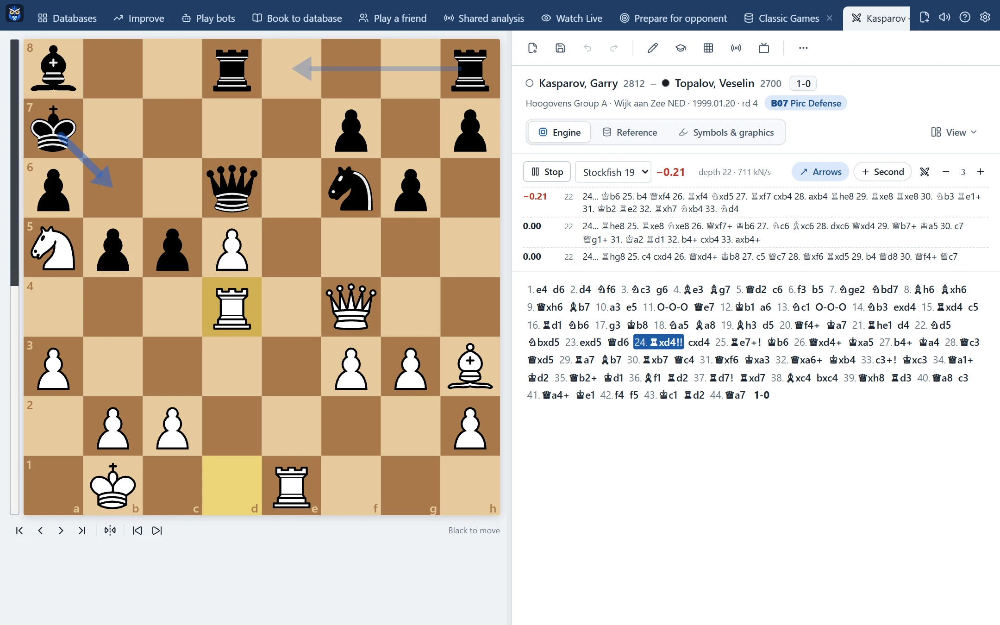
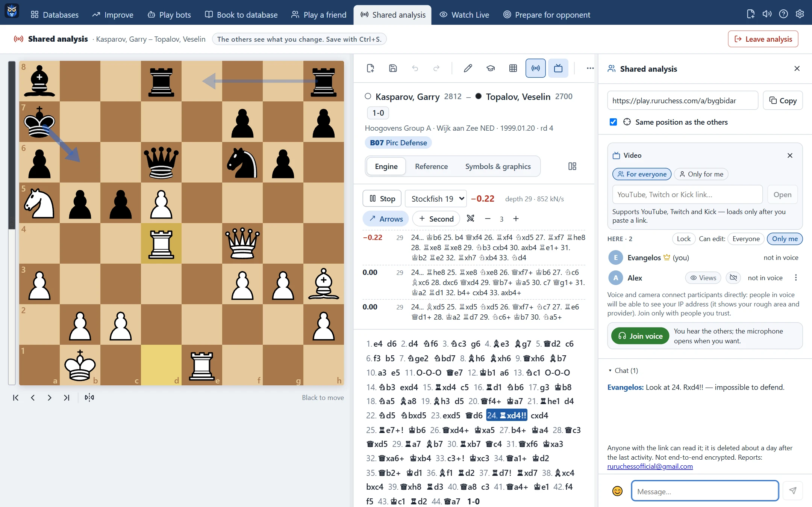
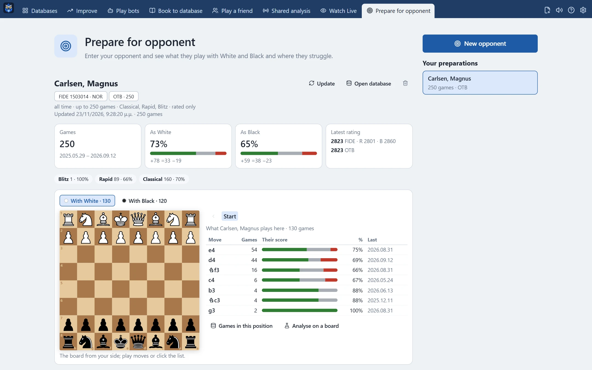
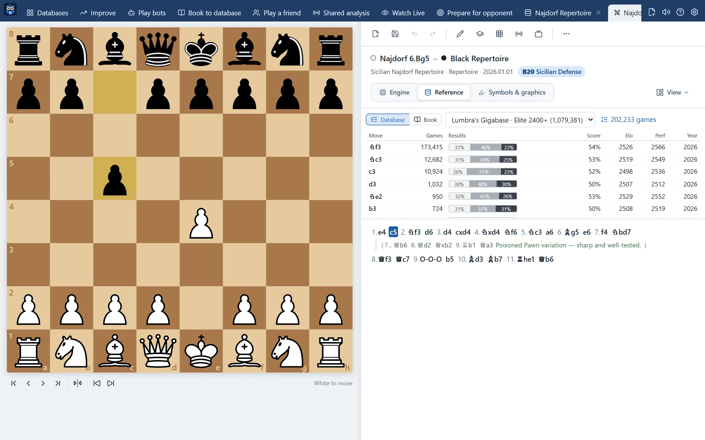
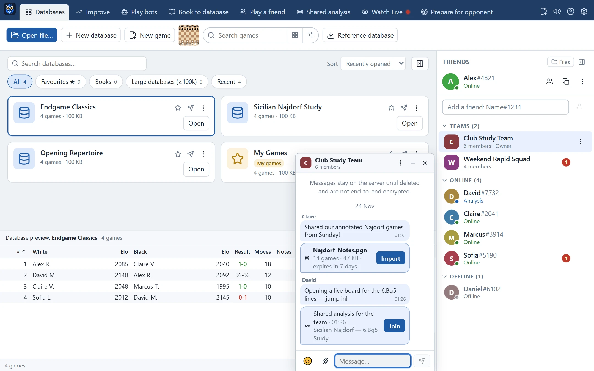

<div align="center">


# Ruru Chess

**Free, open-source chess database, analysis, opponent prep, and live shared study app for Windows 10 & 11.**

[](https://github.com/RuruChess/ruru-chess/releases/latest)
[-1e293b)](https://ruruchess.com/#download)
[](LICENSE)
[](https://ruruchess.com/)

[Download for Windows](https://github.com/RuruChess/ruru-chess/releases/latest) · [Website (English)](https://ruruchess.com/) · [Ιστοσελίδα (Ελληνικά)](https://ruruchess.com/el/) · [Shared Live Analysis](https://ruruchess.com/live-chess-analysis/)

</div>

---

<p align="center">
  
</p>

**Ruru Chess** opens **PGN**, **ChessBase (`.cbh`, `.cbv`)**, and **Scid (`.si4`)** databases directly on your computer (read-only, even inside `.7z` or `.zip` archives) and brings Stockfish/Lc0/Maia analysis, live shared study with voice & video, opponent preparation, friends & study teams, Watch Live tournaments, tactics, lessons, and local PDF chess book import into one fast standalone Windows app. No ads, no subscriptions, and no telemetry.

## Screenshots

| Shared Live Analysis & Video | Opponent Preparation |
| :---: | :---: |
|  |  |
| **Opening Reference & Move Stats** | **Library, Friends & Study Teams** |
|  |  |

## Download & Install

- **Installer (`Ruru-Chess-Setup.exe`)** — standalone Windows installer (bundles Node.js and Electron, no admin rights required). During setup you choose whether to download Stockfish on first launch. No game database is bundled.
- **Portable (`Ruru-Chess-Portable.zip`)** — unzip anywhere and run `Ruru.exe`.
- **Checksums (`SHA256SUMS.txt`)** — SHA-256 verification hashes for every release file.

## Features & Guides

- **[Shared Live Analysis & Video](https://ruruchess.com/live-chess-analysis/):** Analyze games live with a link on `play.ruruchess.com` — guests join from their browser with no account and can move pieces, explore variations, draw arrows, and see your host engine in real time. Includes end-to-end encrypted WebRTC voice/camera, chat, and an embedded YouTube/Twitch/Kick video panel inside Ruru (“For everyone” or “Only for me”).
- **[Local Databases & Search](https://ruruchess.com/free-chess-database-windows/):** Fast SQLite indexes for millions of games; search by player, Elo, ECO, year, exact position, pawn structure, material balance, or piece maneuvers; duplicate detection and database cleanup.
- **[Open `.cbh`, `.cbv`, `.si4` & `.pgn` Files](https://ruruchess.com/open-cbh-cbv-files/):** Read `.pgn`, `.cbh` (with comments, variations, symbols, arrows), `.cbv`, and `.si4` files without modifying originals — even inside `.7z` or `.zip` archives — and export standard PGN anytime.
- **[Offline Analysis & Stockfish GUI](https://ruruchess.com/stockfish-gui-windows/):** Multi-line UCI engine analysis (Stockfish, Lc0, Maia), second engine, threat display, evaluation bar, board arrows, full-game blunder check with accuracy & ACPL graph, opening reference tree, novelty finder, and optional 7-piece Syzygy endgame tablebases.
- **[Opponent Preparation](https://ruruchess.com/chess-opponent-preparation/):** Combine local FIDE/OTB databases with public Lichess and Chess.com usernames you enter into one opponent dossier with White/Black scores, Elo chart, and an interactive opening repertoire tree.
- **[Book to Database (PDF Importer)](https://ruruchess.com/pdf-chess-book-to-pgn/):** Import digital PDF chess books you own (plus basic Windows OCR for scanned pages) into playable databases with variations, commentary, and exercise training mode — 100% locally on your PC.
- **Friends & Study Teams:** Optional account (no email or password, 16+) for a permanent friends list and study teams with roles, live presence, chat, direct PGN file sharing with one-click import, and one-click invites to play or analyze together.
- **Watch Live & Play a Friend:** Follow live chess tournaments with real clocks, open any live game for Stockfish analysis or one-click Shared analysis, or challenge a friend by link in any browser.
- **Training & Bots:** Adaptive Glicko-2 tactics trainer with spaced repetition, timed runs, streaks, cycles, and daily puzzle; 50 interactive strategy lessons; 36 endgame lessons & engine drills; and 10 human-like bots (plus optional Maia networks).
- **Languages & Themes:** English and Greek UI, figurine / English / Greek notation, light & dark themes, multi-window or tabbed layout.

## Run from Source

Requires **Node.js 24+** (https://nodejs.org).

```bash
npm install
npm run build
npm start
```

Or double-click `Ruru.cmd` on Windows.

- Local server listens only on `http://127.0.0.1:4747`.
- Development mode with hot reload: `npm run dev` (`http://127.0.0.1:5317`).
- Run tests: `npm test` (`npm run typecheck`, `npm run smoke`, `npm run e2e`).

## Packaging & Website

- **Release package:** `node scripts/make-release.mjs` builds `Ruru-Chess-Setup.exe`, `Ruru-Chess-Portable.zip`, and `SHA256SUMS.txt` into `release/ruru`.
- **Static website:** `node scripts/build-site.mjs --check` builds the English (`/`) and Greek (`/el/`) site (including feature guides, `sitemap.xml`, `robots.txt`, `_headers`, and `llms.txt`) into `site/dist`.

## Data Storage

- Databases are stored locally in `Documents\Ruru\*.kbdb` (SQLite) alongside position/opening indexes (`*.pos`, `*.tree`).
- Settings and catalog metadata live in a hidden subfolder inside your databases folder.
- Your original PGN / ChessBase / Scid files are never modified; use **Export PGN** anytime.

## Privacy, Terms & Licenses

- **Privacy Policy:** [PRIVACY.md](PRIVACY.md) (English & Greek)
- **Terms of Use:** [TERMS.md](TERMS.md) (English & Greek)
- **Third-Party Credits & Notices:** [CREDITS.md](CREDITS.md) · [licenses/NOTICES.txt](licenses/NOTICES.txt)

## Code Signing Policy

- **Status:** Windows release binaries are currently unsigned while applying for free open-source code signing through [SignPath Foundation](https://signpath.org/). Once approved, official Windows releases will be signed via [SignPath.io](https://signpath.io/) with a certificate issued by SignPath Foundation.
- **Build & Origin:** Starting with the next release (after `v3.0.0`, which was built locally before CI was added), official release artifacts are built cleanly from this public repository via GitHub Actions on GitHub-hosted `windows-latest` runners ([`.github/workflows/release.yml`](.github/workflows/release.yml)).
- **Scope:** Only our packaged application binaries (`Ruru.exe` and `Ruru-Chess-Setup.exe`) will be signed. Bundled third-party CLI tools (`node.exe`, `7za.exe`) are not re-signed.
- **Team & Approval:** Repository maintainer and signing approver is `@bapoliss` (with 2FA enabled on GitHub and SignPath). Every release signing request requires manual approval.
- **Privacy & Behavior:** Ruru Chess has no ads, no analytics, and no telemetry. Databases stay local; all network connections (including default features such as update checks and tablebase queries, and how to disable them) are documented in [PRIVACY.md](PRIVACY.md).

---

Ruru Chess is licensed under **[GPL-3.0-or-later](LICENSE)**, with components under **[AGPL-3.0](licenses/AGPL-3.0.txt)** from Lichess, provided with no warranty. Ruru Chess is not affiliated with ChessBase GmbH, Lichess, Chess.com, FIDE, YouTube, Twitch, Kick, Stockfish, GitHub, or any other mentioned service; all trademarks belong to their respective owners.
